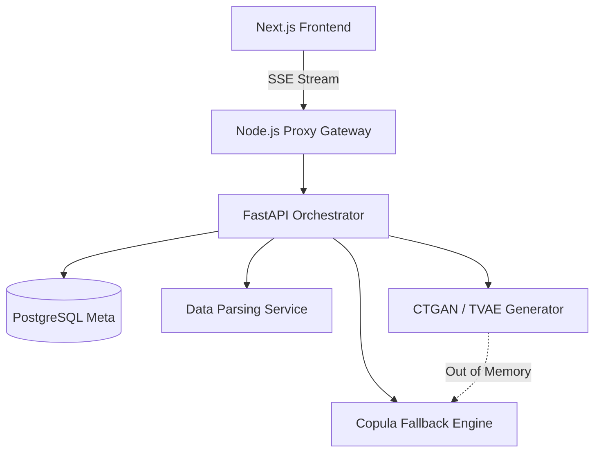

  <h1>Vulpix: Enterprise AI Data Copilot</h1>
  
<b>Agentic data workflows, zero-memory-breach orchestration, and constraint-aware synthesis.</b>

  
  

> **Status (read first):** this repo currently holds the system design and the
> recorded demo. Service implementation is in active development and lands here
> as it stabilizes. Nothing below is claimed as shipped code.

## Demo

- **Demo video:** https://youtu.be/W5a4LwjMa7M
- **Working demo (walkthrough):** https://drive.google.com/file/d/1M_Cmneh1-vPcXN-DN2v_7mt_mPFDTFvc/view?usp=drive_link

## System Architecture

Vulpix is designed as strictly separated microservices orchestrated via Docker
Compose: 17 Python/FastAPI services, a Node.js/Next.js frontend, a Node.js
backend proxy, PostgreSQL, and a Google Cloud Storage (GCS) emulator for
stateless data transfer.

## Design goals

- **Algorithmic fallback:** if deep-learning models hit OOM, the design degrades
  to Copula or Bootstrap modeling to still deliver.
- **Agentic workflow:** LangGraph planner routing data between Imputer,
  Balancer, and Outlier Detector.

Built by Genuity IO (Adari Karthikeya). Part of the Genuity data-engineering
line alongside the [`genuity` PyPI library](https://pypi.org/project/genuity/)
and [Genuity Axiom](https://github.com/AK47-1845/Genuity-Axiom-Core).
